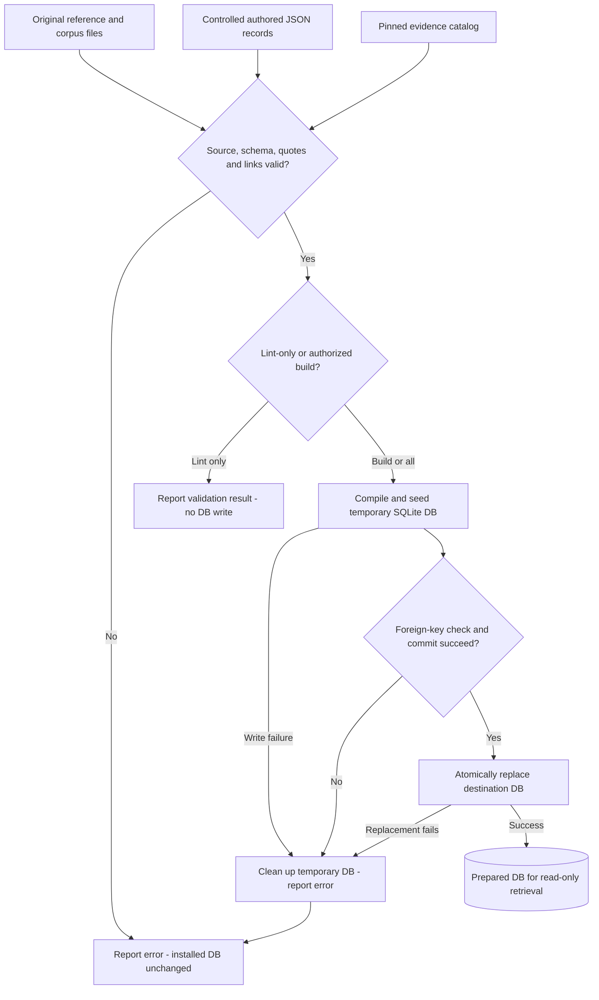
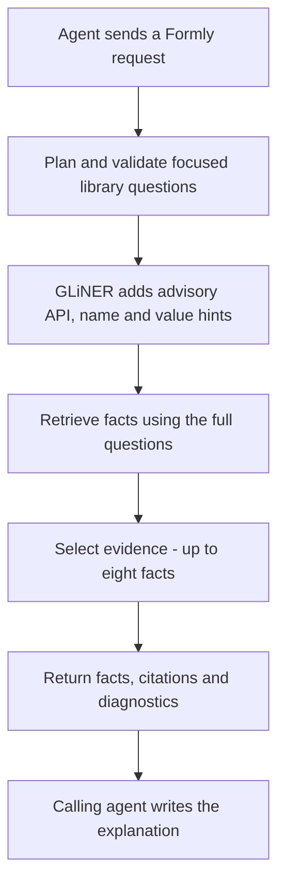
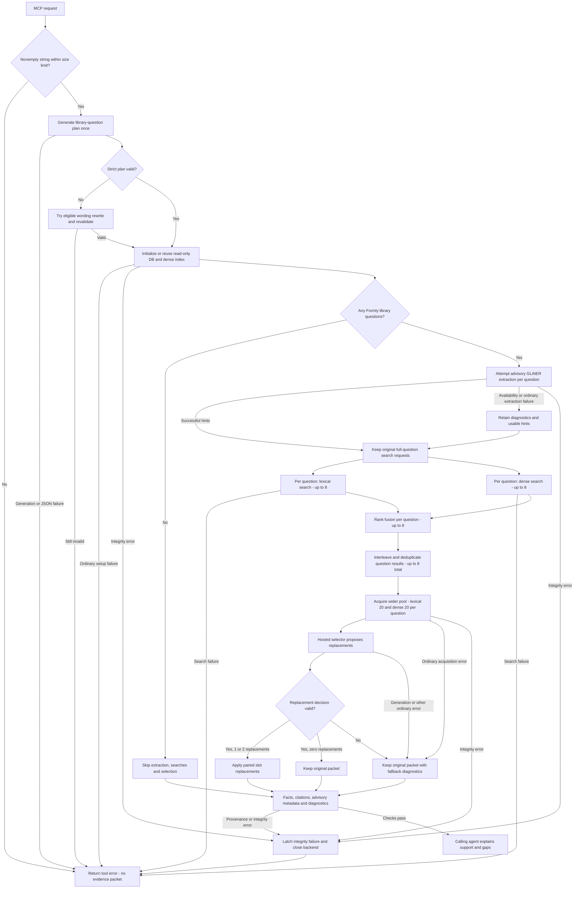

# ask-formly

### Formly knowledge your coding agent can cite.

[](https://github.com/dills122/ask-formly/actions/workflows/ci.yml)
[](docs/readiness.md)
[](docs/knowledge-pipeline.md)

**ask-formly is a source-grounded knowledge service for the Formly library, exposed to coding agents through the Model Context Protocol (MCP).** It turns a developer's request into focused library questions, retrieves curated facts, and returns evidence the agent can use to explain its answer.

The goal is to give agents a dependable place to look up Formly behavior: custom types, registration, expressions, model values, visibility, and Material integration—with the conditions and source references that make an answer useful.

**Current stage:** a working local MCP foundation with a deliberately small knowledge sample. The runtime is qualified in an existing provisioned checkout; a one-command public installation is still ahead.

The latest [knowledge-admission milestone](docs/knowledge-admission-session.md) adds a source coverage checklist and scripted admission gates. The reviewed validation batch passed three fixed qualification repeats and is now installed as foundation6: 79 facts across 17 documents. All 15 installation smoke answers passed independent audit; see the [promotion results](poc/contextual-kb/knowledge-expansion/promotion-v5/RESULTS.md).

[How it works](#how-it-works) · [Try the source](#get-started) · [Roadmap](#where-were-going) · [Contribute](CONTRIBUTING.md)

## Why this exists

A useful Formly answer often depends on details that a short search result leaves out. Does hiding a field clear its value? Is a setting a field option, a registered name, or an expression? Does a proposed recipe actually have supporting evidence for the version in use?

ask-formly keeps those distinctions visible. Its knowledge records include claims, conditions, limits, exact source quotations, and evidence links. The agent receives selected facts and provenance, then explains what they support—and where the knowledge base has a gap.

This service answers questions **about the Formly library**. Your coding agent still owns understanding and editing your application. ask-formly does not know your custom `SSNField` or `CitySelector` implementation, and it does not scan your repository.

## What a request looks like

Ask your connected agent:

> In Formly, how can I hide a field without losing its model value? Explain what `resetOnHide: false` changes, including what happens to the form control.

The agent calls the lookup tool:

```text
lookup_formly(request: string, project_id?, worktree_id?, formly_version?, ui_adapter?)
```

Optional [project/worktree settings](docs/project-settings.md) remember the requested version and UI adapter. Unsupported versions return a coverage error recommending web lookup.

The service derives the relevant library questions, retrieves the stored facts, and returns citations and diagnostics. The calling agent writes the final explanation. If the evidence covers only part of the request, that limitation should appear in the answer.

Other library questions to explore include:

- How do I define and register a custom Formly field type?
- How do expressions control field properties and visibility?
- How do default values interact with the model?
- How do wrappers relate to custom field types?

These are examples of the intended question domain, not a promise that the current sample contains every step of every recipe.

## How it works

There are two stages, at different times: **prepare the knowledge base**, then **use that prepared knowledge to handle requests**. Asking a question does not rebuild or reseed the database.

### 1. Data preparation, transpilation, and DB seeding

This is the knowledge-authoring and build process. The current sample contains **79 authored facts across 17 documents**, scoped to **Formly 6.3.12 core and Material**.



| Step | What happens |
| --- | --- |
| **Prepare the source material** | Retain original references, imported corpus material, and a pinned evidence catalog with version and source context. |
| **Author the knowledge records** | Capture claims, conditions, limits, exact source quotes, evidence IDs, and related-fact links in controlled JSON. This is curated knowledge, not automatic ingestion of the entire Formly library. |
| **Validate and compile** | The authored-fact compiler checks source hashes, quotation matches, citations, version scope, and relationships, then converts the records into the database representation. |
| **Seed the DB** | The same compiler writes documents, facts, evidence, relationships, and a full-text search table into a temporary SQLite database. It checks referential integrity and records an input hash before atomically replacing the destination DB. |
| **Use the prepared artifact** | The service opens the installed DB read-only. Source preparation, compilation, and seeding are not part of a question lookup. |

The current DB is built from controlled authored records through `kbcompiler/structured_source.py`. The earlier Markdown import/transpilation path in `kbcompiler/pipeline.py` is also preserved, but it is a separate path—not an automatic step that generates the current authored facts.

**The installed knowledge and DB are frozen.** The diagram explains the build process; it is not a request to run it. Routine verification lints the real sources and tests compilation against disposable fixtures without reseeding the installed DB. See the [knowledge-pipeline guide](docs/knowledge-pipeline.md) for the files, responsibilities, and safe commands.

### 2. Live question understanding and retrieval

#### Major phases at a glance

The service turns a request into library questions, finds supporting knowledge, and gives that evidence back to the calling agent.



This overview shows the major phases of a successful lookup. GLiNER hints are advisory: retrieval keeps the full questions even if extraction fails. Evidence selection can retain the original retrieval packet when its optional refinement fails. Validation errors, empty plans, and the other branches are shown in the detailed flow below.

#### Detailed decisions and fallbacks

This is what happens when a coding agent calls `lookup_formly`, after launcher preflight has passed. It uses the database prepared in stage 1. **The branches show decisions and data dependencies, not parallel threads:** requests are serialized; extraction runs before retrieval, and the lexical and dense calls are evaluated sequentially.



| Step | What happens |
| --- | --- |
| **Question planning** | Derive Formly library questions while retaining shared conditions, exclusions, and linked follow-ups. |
| **Wording validation** | Handle a narrow, tested wording variation while continuing to reject genuinely lost conditions. |
| **Advisory extraction** | Frozen GLiNER models add API/name/value annotations. Full questions remain the retrieval input; annotations do not replace them or filter out facts. |
| **Hybrid retrieval** | Search the prepared knowledge using lexical and dense signals. The stored DB is not modified. |
| **Evidence selection** | Make bounded changes to a packet of at most eight facts, retaining the original packet as a fallback. |
| **Response and explanation** | Return stored facts, provenance, advisory annotations, and diagnostics. The calling agent writes the final explanation and identifies missing support. |

The branches have specific limits:

- **Empty plans:** a valid plan with no library questions returns no facts and marks extraction/selection as unnecessary. Backend initialization still happens before this branch.
- **Advisory extraction:** the default service attempts GLiNER when questions exist. Ordinary load/inference errors or malformed output can degrade annotations without changing the full-question searches. Extractor loading is attempted once per backend; it is not retried automatically on every request.
- **Lexical fallback:** each lexical search tries an AND query first, then OR only if AND returns no results. No usable terms yields no lexical results. Dense retrieval uses in-memory fact vectors initialized from the DB with the locally cached embedding model; those vectors are not seeded into SQLite by the authored-fact compiler.
- **Selection fallback:** the wider pool includes the original packet. Only a validated decision can replace at most two existing slots. A valid zero-replacement decision is `unchanged`; an acquisition/selector/decision error is `fallback`. Both retain the original packet, but report different diagnostics. An empty original packet is not filled by this replacement policy.
- **Errors that do not fall back:** ordinary failures in baseline retrieval propagate as tool errors. A confirmed integrity error from model/DB checks or missing stored provenance bypasses optional fallbacks, closes the backend, and causes later calls on that service instance to fail until it is restarted. These guards also run outside the GLiNER step shown in the diagram.

There is no automatic retry of hosted planning or selection. The diagram groups response assembly for readability; stored provenance and integrity checks must succeed before a response is returned.

The planner and selector currently use a hosted model through an authenticated Codex CLI. Extraction and knowledge retrieval run locally. This is **not an entirely offline service**; see the [runtime setup guide](poc/contextual-kb/mcp_foundation/README.md) for provider access, timeouts, local diagnostics, and failure behavior.


#### Code behind these diagrams

| Behavior | Implementation checked |
| --- | --- |
| Lint/build branches and atomic DB seeding | [`kbcompiler/__main__.py`](poc/contextual-kb/kbcompiler/__main__.py), [`structured_source.py`](poc/contextual-kb/kbcompiler/structured_source.py) |
| One-shot planning, optional wording rewrite, serialized requests and fatal integrity state | [`planner.py`](poc/contextual-kb/mcp_v1/planner.py), [`candidate.py`](poc/contextual-kb/wording_candidate_v1/candidate.py), [`service.py`](poc/contextual-kb/mcp_v1/service.py) |
| Optional hints, degraded extraction and unchanged search projection | [`lookup.py`](poc/contextual-kb/agent_contract/advisory_lookup_v1/lookup.py), [`GLiNER integration`](poc/contextual-kb/agent_contract/gliner_integration_v1/integration.py) |
| Lexical/dense fusion and cross-question merging | [`question_pilot.py`](poc/contextual-kb/kbcompiler/question_pilot.py), [`retrieval bridge`](poc/contextual-kb/agent_contract/retrieval_integration_v1/bridge.py) |
| Wider candidate pool, replacement validation and fallback | [`policy.py`](poc/contextual-kb/retrieval_repair_v1/policy.py), [`retrieval integration`](poc/contextual-kb/retrieval_repair_v1/integration.py) |
| Read-only DB, resource reuse, citations and integrity checks | [`backend.py`](poc/contextual-kb/mcp_v1/backend.py), [`launcher.py`](poc/contextual-kb/mcp_foundation/launcher.py) |

## Get started

### Explore and check the source

You can inspect the implementation and run source checks without downloading models or provisioning the service. Use Python 3.13:

```sh
git clone https://github.com/dills122/ask-formly.git
cd ask-formly
python3.13 -m venv .venv
. .venv/bin/activate
python -m pip install 'markdown-it-py>=3,<5' 'PyYAML>=6,<7' -r poc/contextual-kb/mcp_v1/requirements-context.txt
python tools/project.py source
```

This validates preserved source/provenance and runs compiler and packaging tests using temporary fixtures. It does **not** qualify model inference or start the MCP server.

### Run the provisioned MCP

The current runtime needs its installed DB, base model, frozen adapters, embedding cache, Python environments, and authenticated provider access. Those assets are not all included in a source clone.

In an existing provisioned checkout:

```sh
poc/contextual-kb/mcp_v1/.venv/bin/python -B poc/contextual-kb/mcp_foundation/launcher.py doctor
poc/contextual-kb/mcp_v1/.venv/bin/python -B poc/contextual-kb/mcp_foundation/launcher.py serve
```

`serve` starts a **stdio MCP server**, not an interactive question prompt. Connect it through your agent's MCP configuration. The [setup guide and client examples](poc/contextual-kb/mcp_foundation/README.md) cover absolute paths, model selection, timeouts, and recovery.

## What is established—and what is next

The accepted foundation has been exercised through real calling agents, repeated question batches, extraction trials, retrieval diagnostics, local transport tests, and independent reviews. We retain failed experiments alongside successes so that later work starts from evidence.

Current maintenance checks include:

- **128 source/compiler/package/context tests** available without private runtime assets.
- **114 active regression tests** in the provisioned local workflow, including packaging checks also exercised by the source suite.
- **86 pinned runtime/asset checks** in the launcher's doctor.
- Separate live checks of both frozen extractors, the read-only database, and MCP transport.

Those checks establish specific behavior. They are not a whole-library accuracy score. Fresh-machine installation, broader version coverage, production hosting, and unseen overall answer quality remain open work. [Read the current limits](docs/readiness.md).

## Where we're going

The next phase builds on this foundation rather than restarting the architecture.

| Milestone | Direction | What would demonstrate progress |
| --- | --- | --- |
| **Accepted foundation** | Keep the selected planner, advisory extractors, knowledge pipeline, and MCP interface together. | Preserved assets, passing regressions, and documented real-agent behavior. **Established locally.** |
| **Repeatable installation** | Define a reproducible way to provision the required environments and permitted runtime assets. | A clean-machine setup and client connection verified from the documentation. |
| **Broader Formly knowledge** | Expand reviewed library coverage through the authored-source/compiler process. | New facts with traceable provenance, explicit version/UI scope, and tests for the questions they support. |
| **End-to-end usability** | Evaluate complete requests through the calling agent and diagnose remaining misses by layer. | Clear separation of missing knowledge, retrieval loss, selection loss, and caller omissions. |
| **Distribution readiness** | Settle packaging, licensing, operational limits, and release criteria. | A documented, repeatable release that accurately states its supported scope. |

These are planned directions, not released features or delivery dates. Models, knowledge inputs, and the installed DB remain frozen until a specific change is reviewed and authorized. Sealed evaluation stays separate from development work.

## Find your way around

| Location | Purpose |
| --- | --- |
| [`poc/contextual-kb/`](poc/contextual-kb/README.md) | Primary implementation; its existing path preserves pinned assets and runtime references. |
| [`mcp_foundation/`](poc/contextual-kb/mcp_foundation/README.md) | Stable launcher, client examples, and accepted runtime manifest. |
| [`authored/`](poc/contextual-kb/authored/) and [`kbcompiler/`](poc/contextual-kb/kbcompiler/) | Knowledge records and compilation/transpilation code. |
| [`docs/`](docs/README.md) | Current setup, development, knowledge process, and readiness. |
| [`skill/ask-formly/references/`](skill/ask-formly/README.md) | Frozen original knowledge provenance; the old application-inspection implementation is retired. |
| [Experiment history](poc/contextual-kb/history/EXPERIMENTS.md) | Approaches tested, results, failed gates, and decisions carried forward. |

## Contributing

Useful contributions include reproducible failures, clearly scoped Formly questions that expose missing coverage, and improvements to setup and documentation. Include the Formly version and UI adapter when reporting behavior. Please use synthetic examples and omit credentials, application-private data, model weights, and sealed evaluation material.

Read [CONTRIBUTING.md](CONTRIBUTING.md) for checks and [the repository policy](docs/repository-policy.md) for branches and merges. `main` uses PRs, passing source checks, and resolved conversations; no second reviewer is mandatory for this maintainer-led stage.

The repository has not yet selected a license for its original project code. Retained upstream notices do not grant a project-wide license; licensing is part of distribution readiness. See [upstream attribution](skill/ask-formly/THIRD_PARTY_NOTICES.md).
