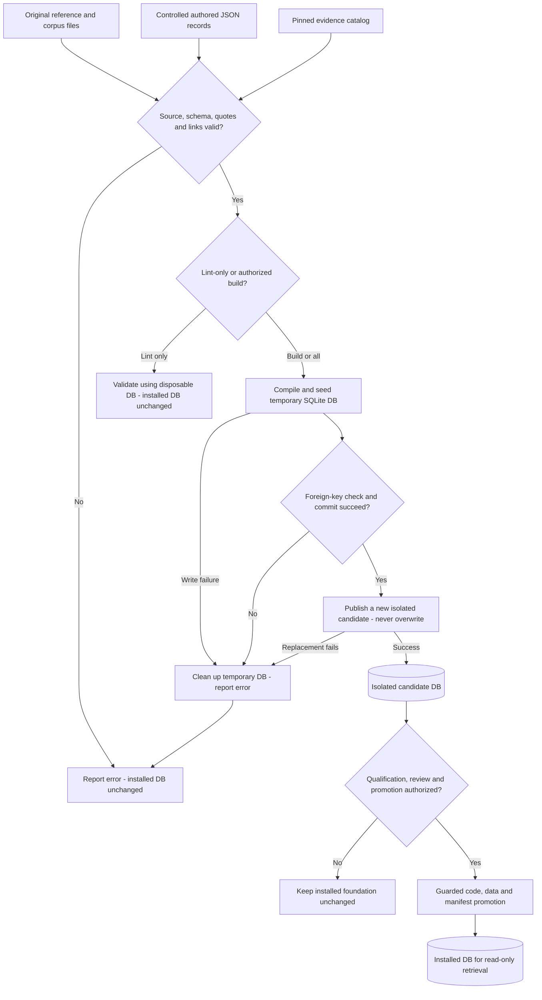
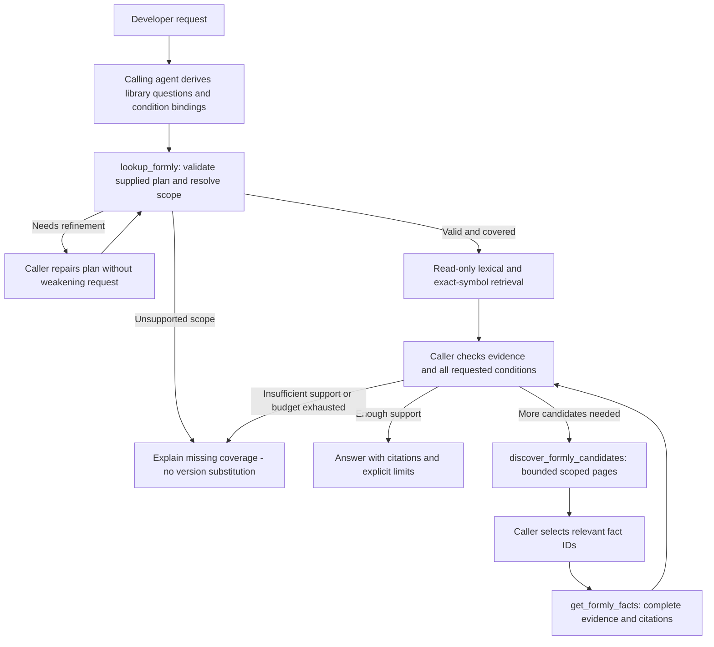
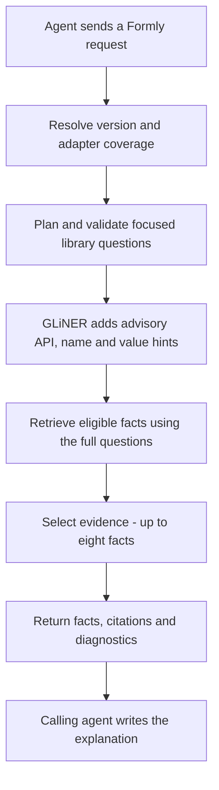
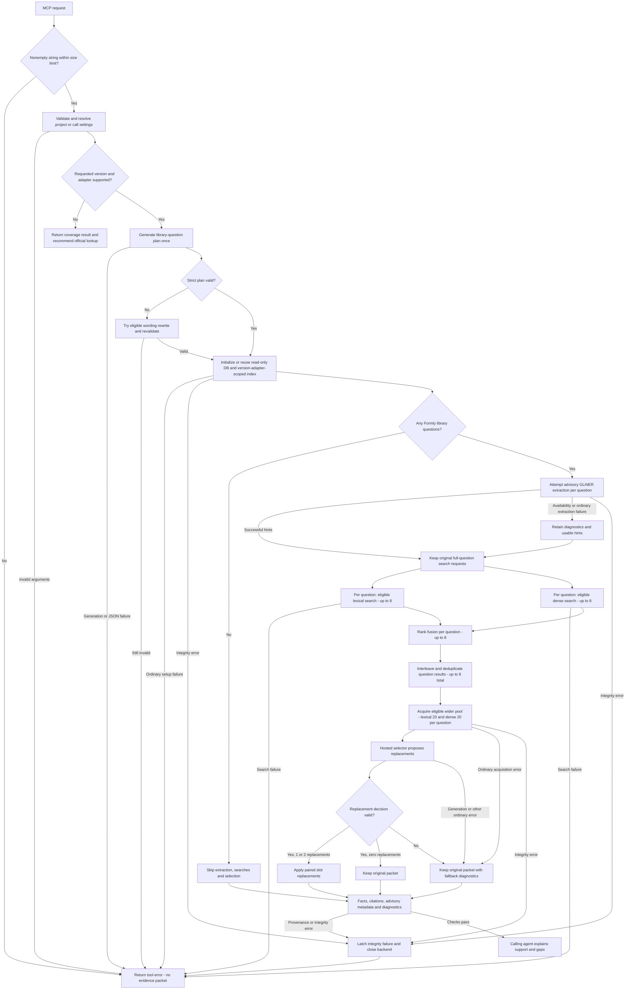

# ask-formly

### Formly knowledge your coding agent can cite.

[](https://github.com/dills122/ask-formly/actions/workflows/ci.yml)
[](docs/readiness.md)
[](docs/knowledge-pipeline.md)

**ask-formly is a source-grounded knowledge service for the Formly library, exposed to coding agents through the Model Context Protocol (MCP).** It retrieves curated facts and returns evidence the agent can use to explain its answer. See [runtime modes](docs/runtime-modes.md) for the choice and agent round trip. Two runtime modes are retained: the default model-free server lets your calling agent plan and select evidence; the opt-in model-backed server keeps the existing hosted planner, advisory GLiNER and hosted selection.

The goal is to give agents a dependable place to look up Formly behavior: custom types, registration, expressions, model values, visibility, and Material integration—with the conditions and source references that make an answer useful.

**Current stage:** model-free alpha preparation. A packaged installer, integrity checks and real MCP self-test have passed clean-environment testing on macOS arm64 with Python 3.14.6. **No public download is published yet.** See [installation](#get-started) for the supplied-archive path and [release readiness](docs/releasing.md) for the remaining gates.

The current knowledge base contains **192 facts across 36 documents**, scoped exactly to **Formly 6.3.12 core/Material**. It covers custom fields and registration, expressions, model values, validation, Material controls, JSON Schema conversion and public API contracts. Both runtimes use the same knowledge. [Three independent caller passes](poc/contextual-kb/history/broad-192-qualification.md) and [installed alpha smoke tests](poc/contextual-kb/alpha/RESULTS.md) provide bounded development evidence—not whole-library accuracy or universal client compatibility.

[Install and connect](#get-started) · [How it works](#how-it-works) · [Roadmap](#where-were-going) · [Contribute](CONTRIBUTING.md)

## Why this exists

A useful Formly answer often depends on details that a short search result leaves out. Does hiding a field clear its value? Is a setting a field option, a registered name, or an expression? Does a proposed recipe actually have supporting evidence for the version in use?

ask-formly keeps those distinctions visible. Its knowledge records include claims, conditions, limits, exact source quotations, and evidence links. The agent receives selected facts and provenance, then explains what they support—and where the knowledge base has a gap.

This service answers questions **about the Formly library**. Your coding agent still owns understanding and editing your application. ask-formly does not know your custom `SSNField` or `CitySelector` implementation, and it does not scan your repository.

## What a request looks like

Ask your connected agent:

> In Formly, how can I hide a field without losing its model value? Explain what `resetOnHide: false` changes, including what happens to the form control.

The agent calls the lookup tool:

```text
lookup_formly(request: string, plan, project_id?, worktree_id?, formly_version?, ui_adapter?)
```

Optional [project/worktree settings](docs/project-settings.md) remember the requested version and UI adapter. Unsupported versions return a coverage error recommending web lookup.

In model-free mode, the calling agent supplies focused questions and their conditions as the plan. The MCP validates that structure, retrieves facts, and exposes discovery/fetch tools when more evidence is needed. The agent selects relevant evidence and writes the final explanation. Model-backed mode accepts the original request without a caller-supplied plan and handles planning internally. Neither mode should turn missing evidence into an invented answer. See [both modes and their contracts](poc/contextual-kb/mcp_runtime/README.md).

Other library questions to explore include:

- How do I define and register a custom Formly field type?
- How do expressions control field properties and visibility?
- How do default values interact with the model?
- How do wrappers relate to custom field types?

These are examples of the intended question domain, not a promise that the current sample contains every step of every recipe.

## Get started

Choose the path that matches what you have:

| You have… | Start here |
| --- | --- |
| An alpha archive and checksum supplied by a maintainer | [Install and connect the model-free alpha](poc/contextual-kb/alpha/README.md). It includes the pinned DB and creates its own Python environment. |
| A provisioned checkout with the DB and runtime environment | [Run the development MCP](poc/contextual-kb/mcp_runtime/README.md), including the separate model-backed option. |
| A fresh Git clone | Run source checks below. **Git does not include the installed DB or model assets**, so cloning alone does not produce a running MCP. |

### Install a supplied alpha archive

The tested target is **macOS arm64 with Python 3.14.6**. The installer accepts Python 3.11+, but other Python/platform combinations remain unqualified. Initial installation requires PyPI access; the MCP itself makes no model/provider calls.

From the directory containing the archive and matching checksum, use a new scratch directory and an absolute, unused installation path:

```sh
shasum -a 256 -c ask-formly-alpha.tar.gz.sha256
mkdir ask-formly-unpack
tar -xzf ask-formly-alpha.tar.gz -C ask-formly-unpack
python3 ask-formly-unpack/ask-formly-alpha/install.py \
  --prefix /absolute/path/to/ask-formly-alpha-install
```

Stop if checksum verification fails. Use your actual archive filename if it differs. Installation verifies files, installs pinned dependencies into a fresh virtual environment, runs doctor and performs a real stdio startup/lookup check. It writes `mcp-config.json` into the installation directory.

In your agent client's MCP setup, create a **local stdio** connection using the generated **command** and **args**. Preserve the absolute paths and `-I` argument; configuration wrappers vary by client. Restart the connection and ask:

> Use ask-formly. For Formly 6.3.12 with Material, how can I hide a field without losing its model value? Explain whether its control stays registered.

A successful caller uses `lookup_formly`, follows up with discovery/fetch when needed, and cites the returned evidence. `ok` means evidence was retrieved, not that the answer is automatically complete. The [full setup guide](poc/contextual-kb/alpha/README.md) includes configuration examples, verification, troubleshooting and upgrades.

### Explore and check the source

Use Python 3.13 for the source-check workflow used by CI:

```sh
git clone https://github.com/dills122/ask-formly.git
cd ask-formly
python3.13 -m venv .venv
. .venv/bin/activate
python -m pip install 'markdown-it-py>=3,<5' 'PyYAML>=6,<7' -r poc/contextual-kb/mcp_v1/requirements-context.txt
python tools/project.py source
```

This validates source/provenance and runs compiler, packaging and scope/retrieval fixture tests without private runtime assets. It does **not** install or start the MCP. Maintainers with the pinned DB can [build an alpha archive](poc/contextual-kb/alpha/README.md#build-from-the-provisioned-repository); the existing [model-backed recovery bundle](poc/contextual-kb/packaging/README.md) serves a different purpose.

## How it works

There are two stages, at different times: **prepare the knowledge base**, then **use that prepared knowledge to handle requests**. Asking a question does not rebuild or reseed the database.

### 1. Data preparation, transpilation, and DB seeding

This is the knowledge-authoring and build process. The current sample contains **192 authored facts across 36 documents**, scoped to **Formly 6.3.12 core and Material**.



| Step | What happens |
| --- | --- |
| **Prepare the source material** | Retain original references, imported corpus material, and a pinned evidence catalog with version and source context. |
| **Author the knowledge records** | Capture claims, conditions, limits, exact source quotes, evidence IDs, and related-fact links in controlled JSON. This is curated knowledge, not automatic ingestion of the entire Formly library. |
| **Validate and compile** | The authored-fact compiler checks source hashes, quotation matches, citations, version scope, and relationships, then converts the records into the database representation. |
| **Seed the DB** | The same compiler writes documents, facts, evidence, relationships, and a full-text search table into a temporary SQLite database. It checks referential integrity and records an input hash before publishing a new isolated candidate. Promotion to the installed path is a separate reviewed operation. |
| **Use the prepared artifact** | The service opens the installed DB read-only. Source preparation, compilation, and seeding are not part of a question lookup. |

The current schema-2 DB is built from controlled authored records through `kbcompiler/current_source.py` and the versioned compiler. Facts have explicit version applicability linked to pinned evidence releases. The legacy `structured_source.py` validates the unchanged content/provenance projection. The earlier Markdown import/transpilation path in `kbcompiler/pipeline.py` is also preserved, but it is a separate path—not an automatic step that generates the current authored facts.

**The installed knowledge and DB are frozen.** The diagram explains the build process; it is not a request to run it. Routine verification lints the real sources and tests compilation against disposable fixtures without reseeding the installed DB. See the [knowledge-pipeline guide](docs/knowledge-pipeline.md) for the files, responsibilities, and safe commands.

### 2. Live question understanding and retrieval

#### Model-free flow (default)



The MCP performs no model inference in this mode. The invoking agent still reasons
under its own harness and policies. Discovery does not certify relevance, and the
caller must fetch full citations for selected discovery candidates. No failure
silently switches to the model-backed mode.

#### Model-backed major phases (opt-in)

The service turns a request into library questions, finds supporting knowledge, and gives that evidence back to the calling agent.



This overview shows the major phases of a successful lookup. GLiNER hints are advisory: retrieval keeps the full questions even if extraction fails. Evidence selection can retain the original retrieval packet when its optional refinement fails. Validation errors, empty plans, and the other branches are shown in the detailed flow below.

#### Model-backed decisions and fallbacks

This is what happens when a coding agent calls `lookup_formly`, after launcher preflight has passed. It uses the database prepared in stage 1. **The branches show decisions and data dependencies, not parallel threads:** requests are serialized; extraction runs before retrieval, and the lexical and dense calls are evaluated sequentially.



| Step | What happens |
| --- | --- |
| **Question planning** | Derive Formly library questions while retaining shared conditions, supplied premises, exclusions, and linked follow-ups. Bare API lookup targets do not become invented conditions. |
| **Wording validation** | Handle a narrow, tested wording variation while continuing to reject genuinely lost conditions. |
| **Advisory extraction** | Frozen GLiNER models add API/name/value annotations. Full questions remain the retrieval input; annotations do not replace them or filter out facts. |
| **Hybrid retrieval** | Filter facts by explicit version applicability and adapter before lexical/dense ranking limits. The stored DB is not modified. |
| **Evidence selection** | Make bounded changes to a packet of at most eight facts, retaining the original packet as a fallback. |
| **Response and explanation** | Return stored facts, provenance, advisory annotations, and diagnostics. The calling agent writes the final explanation and identifies missing support. |

The branches have specific limits:

- **Empty plans:** a valid plan with no library questions returns no facts and marks extraction/selection as unnecessary. Backend initialization still happens before this branch.
- **Advisory extraction:** the model-backed service attempts GLiNER when questions exist. Ordinary load/inference errors or malformed output can degrade annotations without changing the full-question searches. Extractor loading is attempted once per backend; it is not retried automatically on every request.
- **Lexical fallback:** each lexical search tries an AND query first, then OR only if AND returns no results. No usable terms yields no lexical results. Dense retrieval uses in-memory fact vectors initialized from the DB with the locally cached embedding model; those vectors are not seeded into SQLite by the authored-fact compiler.
- **Selection fallback:** the wider pool includes the original packet. Only a validated decision can replace at most two existing slots. A valid zero-replacement decision is `unchanged`; an acquisition/selector/decision error is `fallback`. Both retain the original packet, but report different diagnostics. An empty original packet is not filled by this replacement policy.
- **Errors that do not fall back:** ordinary failures in baseline retrieval propagate as tool errors. A confirmed integrity error from model/DB checks or missing stored provenance bypasses optional fallbacks, closes the backend, and causes later calls on that service instance to fail until it is restarted. These guards also run outside the GLiNER step shown in the diagram.

There is no automatic retry of hosted planning or selection. The diagram groups response assembly for readability; stored provenance and integrity checks must succeed before a response is returned.

The model-backed planner and selector use a hosted model through an authenticated Codex CLI. Its extraction and knowledge retrieval run locally. This mode is **not an entirely offline service**, regardless of which agent calls it. The default model-free mode makes none of those internal model/CLI calls. See the [mode selection guide](poc/contextual-kb/mcp_runtime/README.md) and [model-backed details](poc/contextual-kb/mcp_foundation/README.md).


#### Code behind these diagrams

| Behavior | Implementation checked |
| --- | --- |
| Explicit runtime selection without cross-mode fallback | [Dual-mode launcher](poc/contextual-kb/mcp_runtime/launcher.py) |
| Model-free validation, retrieval and caller-led discovery | [Repair feedback](poc/contextual-kb/model_free_repair_v1/feedback.py), [retrieval](poc/contextual-kb/model_free_v1/candidate.py), [discovery](poc/contextual-kb/parity_v1/discovery.py) |
| Lint/build branches and atomic DB seeding | [`kbcompiler/__main__.py`](poc/contextual-kb/kbcompiler/__main__.py), [`current_source.py`](poc/contextual-kb/kbcompiler/current_source.py), [`versioned compiler`](poc/contextual-kb/versioned_knowledge_v1/compiler.py) |
| One-shot planning, optional wording rewrite, serialized requests and fatal integrity state | [`qualified planner`](poc/contextual-kb/condition_candidate_v2/planner.py), [`shared planner transport`](poc/contextual-kb/mcp_v1/planner.py), [`candidate.py`](poc/contextual-kb/wording_candidate_v1/candidate.py), [`service.py`](poc/contextual-kb/mcp_v1/service.py) |
| Optional hints, degraded extraction and unchanged search projection | [`lookup.py`](poc/contextual-kb/agent_contract/advisory_lookup_v1/lookup.py), [`GLiNER integration`](poc/contextual-kb/agent_contract/gliner_integration_v1/integration.py) |
| Lexical/dense fusion and cross-question merging | [`question_pilot.py`](poc/contextual-kb/kbcompiler/question_pilot.py), [`retrieval bridge`](poc/contextual-kb/agent_contract/retrieval_integration_v1/bridge.py) |
| Wider candidate pool, replacement validation and fallback | [`policy.py`](poc/contextual-kb/retrieval_repair_v1/policy.py), [`retrieval integration`](poc/contextual-kb/retrieval_repair_v1/integration.py) |
| Read-only DB, resource reuse, citations and integrity checks | [`backend.py`](poc/contextual-kb/mcp_v1/backend.py), [`launcher.py`](poc/contextual-kb/mcp_foundation/launcher.py) |

## What is established—and what is next

The accepted foundation has been exercised through real calling agents, repeated question batches, extraction trials, retrieval diagnostics, local transport tests, and independent reviews. We retain failed experiments alongside successes so that later work starts from evidence.

Current evidence includes:

- Source/provenance validation and compiler, installer and retrieval fixture tests without private runtime assets.
- **161 active MCP regressions** in the provisioned local maintenance workflow, plus both runtime doctors.
- Clean-environment installation, real stdio checks and fresh calling-agent smoke tests of the packaged model-free runtime.
- Independent reviews and a documented recovery fix for a JSON Schema retrieval miss; historical failures remain in the results.

These checks establish specific behavior, not a whole-library accuracy score. A physically separate machine, other operating systems, Claude/Kiro integration, broader version coverage and production hosting remain unqualified. [Read the current limits](docs/readiness.md).

## Where we're going

The next phase builds on this foundation rather than restarting the architecture.

The [knowledge completion backlog](docs/knowledge-completion-backlog.md) records the installed 192 facts, completed admission packages, qualification evidence, and explicit exclusions and deferrals.

| Milestone | Direction | What would demonstrate progress |
| --- | --- | --- |
| **Accepted foundation** | Retain caller-led model-free operation and the separate model-backed option. | Preserved assets, passing regressions, and documented real-agent behavior. **Established locally.** |
| **Repeatable installation** | Package the model-free runtime and pinned knowledge with a verified installer. | **Clean-environment testing established on macOS arm64.** Next: an independent machine/client setup from the published instructions. |
| **Broader Formly knowledge** | Expand reviewed library coverage through the authored-source/compiler process. | New facts with traceable provenance, explicit version/UI scope, and tests for the questions they support. |
| **End-to-end usability** | Evaluate complete requests through the calling agent and diagnose remaining misses by layer. | Clear separation of missing knowledge, retrieval loss, selection loss, and caller omissions. |
| **Distribution readiness** | Settle packaging, licensing, operational limits, and release criteria. | A documented, repeatable release that accurately states its supported scope. |

Version-aware storage and filtering are installed, but coverage remains exactly Formly 6.3.12. See the [versioning promotion](poc/contextual-kb/versioned_promotion_v1/RESULTS.md). Additional releases require separate evidence review and admission. These roadmap directions are not promises of release dates. Models, knowledge inputs, and the installed DB remain frozen until a specific change is reviewed and authorized. Sealed evaluation stays separate from development work.

## Find your way around

| Location | Purpose |
| --- | --- |
| [`poc/contextual-kb/`](poc/contextual-kb/README.md) | Primary implementation; its existing path preserves pinned assets and runtime references. |
| [`mcp_foundation/`](poc/contextual-kb/mcp_foundation/README.md) | Retained model-backed launcher, client examples, and runtime manifest. |
| [`alpha/`](poc/contextual-kb/alpha/README.md) | Model-free package, installer, client setup and alpha qualification. |
| [`mcp_runtime/`](poc/contextual-kb/mcp_runtime/README.md) | Default model-free entry point and explicit retained model-backed option. |
| [`authored/`](poc/contextual-kb/authored/) and [`kbcompiler/`](poc/contextual-kb/kbcompiler/) | Knowledge records and compilation/transpilation code. |
| [`docs/`](docs/README.md) | Current setup, development, knowledge process, and readiness. |
| [`skill/ask-formly/references/`](skill/ask-formly/README.md) | Frozen original knowledge provenance; the old application-inspection implementation is retired. |
| [Experiment history](poc/contextual-kb/history/EXPERIMENTS.md) | Approaches tested, results, failed gates, and decisions carried forward. |

## Contributing

Useful contributions include reproducible failures, clearly scoped Formly questions that expose missing coverage, and improvements to setup and documentation. Include the Formly version and UI adapter when reporting behavior. Please use synthetic examples and omit credentials, application-private data, model weights, and sealed evaluation material.

Read [CONTRIBUTING.md](CONTRIBUTING.md) for checks and [the repository policy](docs/repository-policy.md) for branches and merges. `main` uses PRs, passing source checks, and resolved conversations; no second reviewer is mandatory for this maintainer-led stage.

The repository has not yet selected a license for its original project code. Retained upstream notices do not grant a project-wide license; licensing is part of distribution readiness. See [upstream attribution](skill/ask-formly/THIRD_PARTY_NOTICES.md).
