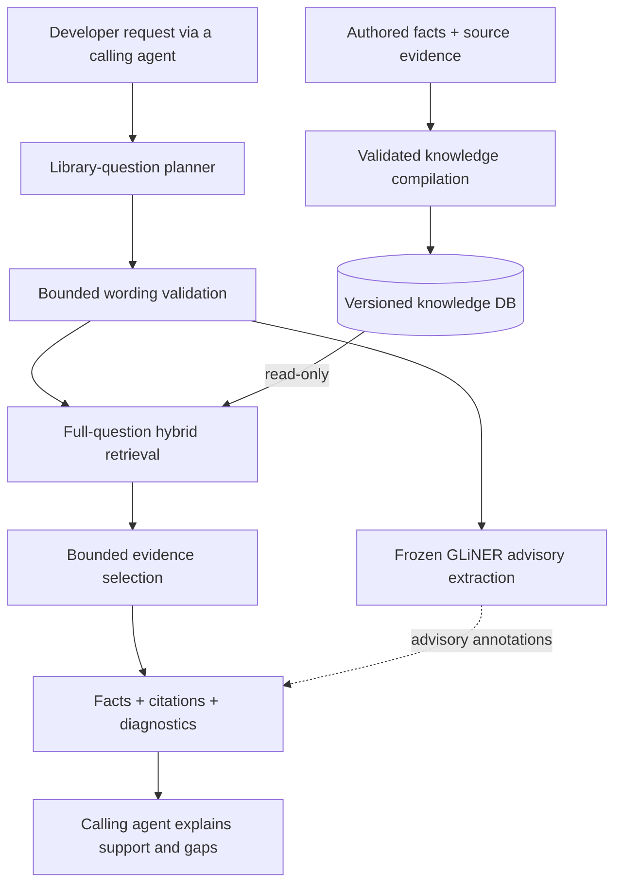

# ask-formly

### Formly knowledge your coding agent can cite.

[](https://github.com/dills122/ask-formly/actions/workflows/ci.yml)
[](docs/readiness.md)
[](docs/knowledge-pipeline.md)

**ask-formly is a source-grounded knowledge service for the Formly library, exposed to coding agents through the Model Context Protocol (MCP).** It turns a developer's request into focused library questions, retrieves curated facts, and returns evidence the agent can use to explain its answer.

The goal is to give agents a dependable place to look up Formly behavior: custom types, registration, expressions, model values, visibility, and Material integration—with the conditions and source references that make an answer useful.

**Current stage:** a working local MCP foundation with a deliberately small knowledge sample. The runtime is qualified in an existing provisioned checkout; a one-command public installation is still ahead.

[How it works](#how-it-works) · [Try the source](#get-started) · [Roadmap](#where-were-going) · [Contribute](CONTRIBUTING.md)

## Why this exists

A useful Formly answer often depends on details that a short search result leaves out. Does hiding a field clear its value? Is a setting a field option, a registered name, or an expression? Does a proposed recipe actually have supporting evidence for the version in use?

ask-formly keeps those distinctions visible. Its knowledge records include claims, conditions, limits, exact source quotations, and evidence links. The agent receives selected facts and provenance, then explains what they support—and where the knowledge base has a gap.

This service answers questions **about the Formly library**. Your coding agent still owns understanding and editing your application. ask-formly does not know your custom `SSNField` or `CitySelector` implementation, and it does not scan your repository.

## What a request looks like

Ask your connected agent:

> In Formly, how can I hide a field without losing its model value? Explain what `resetOnHide: false` changes, including what happens to the form control.

The agent calls the single tool:

```text
lookup_formly(request: string)
```

The service derives the relevant library questions, retrieves the stored facts, and returns citations and diagnostics. The calling agent writes the final explanation. If the evidence covers only part of the request, that limitation should appear in the answer.

Other library questions to explore include:

- How do I define and register a custom Formly field type?
- How do expressions control field properties and visibility?
- How do default values interact with the model?
- How do wrappers relate to custom field types?

These are examples of the intended question domain, not a promise that the current sample contains every step of every recipe.

## How it works



| Part | What it contributes |
| --- | --- |
| **Question planner** | Derives Formly library questions while retaining shared conditions, exclusions, and linked follow-ups. |
| **Wording validation** | Handles a narrow, tested wording variation while continuing to reject genuinely lost conditions. |
| **GLiNER extraction** | Adds API/name/value annotations from frozen models. These are advisory; full questions remain the retrieval input. |
| **Hybrid retrieval** | Searches the existing knowledge using lexical and dense signals. |
| **Evidence selection** | Makes bounded changes to an eight-fact packet, retaining the original packet as a fallback. |
| **MCP response** | Returns stored facts and provenance. The calling agent remains responsible for its final answer. |

The planner and selector currently use a hosted model through an authenticated Codex CLI. Extraction and knowledge retrieval run locally. This is **not an entirely offline service**; see the [runtime setup guide](poc/contextual-kb/mcp_foundation/README.md) for provider access, timeouts, local diagnostics, and failure behavior.

## The knowledge behind the answers

The current sample contains **46 authored facts across 9 documents**, scoped to **Formly 6.3.12 core and Material**. It is a starting foundation, not a complete mirror of Formly documentation.

Knowledge is kept as inspectable source material:

1. **Original references and evidence** establish the source and version context.
2. **Authored JSON records** capture individual facts, conditions, limits, quotes, citations, and related facts.
3. **The compiler** validates source hashes, exact quotations, evidence references, and relationships before producing the database.
4. **Retrieval opens the installed DB read-only.** Routine checks do not rebuild it.

Both the current authored-fact compiler and the earlier Markdown import/transpilation path are preserved. Their roles and safe verification commands are explained in the [knowledge-pipeline guide](docs/knowledge-pipeline.md).

## Get started

### Explore and check the source

You can inspect the implementation and run source checks without downloading models or provisioning the service. Use Python 3.13:

```sh
git clone https://github.com/dills122/ask-formly.git
cd ask-formly
python3.13 -m venv .venv
. .venv/bin/activate
python -m pip install 'markdown-it-py>=3,<5' 'PyYAML>=6,<7'
python tools/project.py source
```

This validates preserved source/provenance and runs compiler and packaging tests using temporary fixtures. It does **not** qualify model inference or start the MCP server.

### Run the provisioned MCP

The current runtime needs its installed DB, base model, frozen adapters, embedding cache, Python environments, and authenticated provider access. Those assets are not all included in a source clone.

In an existing provisioned checkout:

```sh
poc/contextual-kb/mcp_v1/.venv/bin/python -B poc/contextual-kb/mcp_foundation/launcher.py doctor
poc/contextual-kb/mcp_v1/.venv/bin/python -B poc/contextual-kb/mcp_foundation/launcher.py serve
```

`serve` starts a **stdio MCP server**, not an interactive question prompt. Connect it through your agent's MCP configuration. The [setup guide and client examples](poc/contextual-kb/mcp_foundation/README.md) cover absolute paths, model selection, timeouts, and recovery.

## What is established—and what is next

The accepted foundation has been exercised through real calling agents, repeated question batches, extraction trials, retrieval diagnostics, local transport tests, and independent reviews. We retain failed experiments alongside successes so that later work starts from evidence.

Current maintenance checks include:

- **31 source/compiler/package tests** available without private runtime assets.
- **76 accepted regression tests** in the provisioned local workflow, including packaging checks also exercised by the source suite.
- **75 pinned runtime/asset checks** in the launcher's doctor.
- Separate live checks of both frozen extractors, the read-only database, and MCP transport.

Those checks establish specific behavior. They are not a whole-library accuracy score. Fresh-machine installation, broader version coverage, production hosting, and unseen overall answer quality remain open work. [Read the current limits](docs/readiness.md).

## Where we're going

The next phase builds on this foundation rather than restarting the architecture.

| Milestone | Direction | What would demonstrate progress |
| --- | --- | --- |
| **Accepted foundation** | Keep the selected planner, advisory extractors, knowledge pipeline, and MCP interface together. | Preserved assets, passing regressions, and documented real-agent behavior. **Established locally.** |
| **Repeatable installation** | Define a reproducible way to provision the required environments and permitted runtime assets. | A clean-machine setup and client connection verified from the documentation. |
| **Broader Formly knowledge** | Expand reviewed library coverage through the authored-source/compiler process. | New facts with traceable provenance, explicit version/UI scope, and tests for the questions they support. |
| **End-to-end usability** | Evaluate complete requests through the calling agent and diagnose remaining misses by layer. | Clear separation of missing knowledge, retrieval loss, selection loss, and caller omissions. |
| **Distribution readiness** | Settle packaging, licensing, operational limits, and release criteria. | A documented, repeatable release that accurately states its supported scope. |

These are planned directions, not released features or delivery dates. Models, knowledge inputs, and the installed DB remain frozen until a specific change is reviewed and authorized. Sealed evaluation stays separate from development work.

## Find your way around

| Location | Purpose |
| --- | --- |
| [`poc/contextual-kb/`](poc/contextual-kb/README.md) | Primary implementation; its existing path preserves pinned assets and runtime references. |
| [`mcp_foundation/`](poc/contextual-kb/mcp_foundation/README.md) | Stable launcher, client examples, and accepted runtime manifest. |
| [`authored/`](poc/contextual-kb/authored/) and [`kbcompiler/`](poc/contextual-kb/kbcompiler/) | Knowledge records and compilation/transpilation code. |
| [`docs/`](docs/README.md) | Current setup, development, knowledge process, and readiness. |
| [`skill/ask-formly/references/`](skill/ask-formly/README.md) | Frozen original knowledge provenance; the old application-inspection implementation is retired. |
| [Experiment history](poc/contextual-kb/history/EXPERIMENTS.md) | Approaches tested, results, failed gates, and decisions carried forward. |

## Contributing

Useful contributions include reproducible failures, clearly scoped Formly questions that expose missing coverage, and improvements to setup and documentation. Include the Formly version and UI adapter when reporting behavior. Please use synthetic examples and omit credentials, application-private data, model weights, and sealed evaluation material.

Read [CONTRIBUTING.md](CONTRIBUTING.md) for checks and [the repository policy](docs/repository-policy.md) for branches and merges. `main` uses PRs, passing source checks, and resolved conversations; no second reviewer is mandatory for this maintainer-led stage.

The repository has not yet selected a license for its original project code. Retained upstream notices do not grant a project-wide license; licensing is part of distribution readiness. See [upstream attribution](skill/ask-formly/THIRD_PARTY_NOTICES.md).
